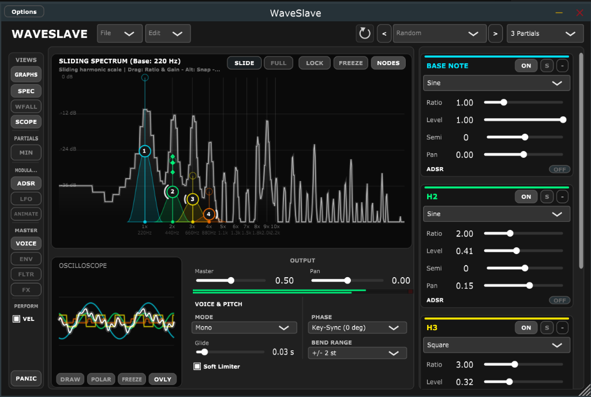
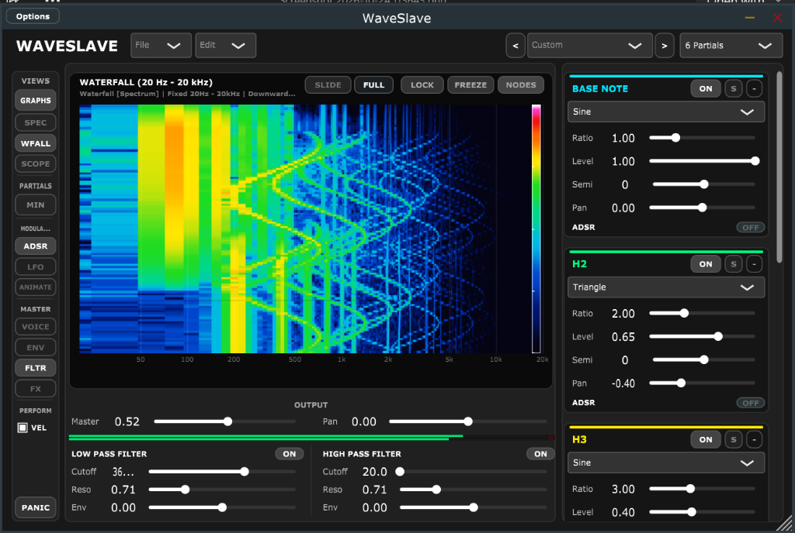

# WaveSlave

WaveSlave is a 16-partial additive synthesizer audio plugin and standalone application written in C++ using the JUCE framework. It provides direct control over the harmonic ratios, levels, envelopes, panning, and dynamic keyframe trajectories of individual partials, combined with user-drawn wavetables and real-time spectral analysis tools.

## Features

### Additive Synthesis Engine
* **16 Independent Partials**: Each partial features individual waveform selection, continuous frequency ratio tuning (0.01x to 32.0x), coarse transposition (-24 to +24 semitones), stereo panning, and level controls.
* **Harmonic Presets and Roll-offs**: Edit harmonic structures using predefined mathematical series (Natural, Odd, Even, Octaves, Inharmonic / Bell) and gain roll-off profiles (1/n, 1/n^2, Flat, Inverted, Fundamental Only).
* **Oscillator Waveforms**: Built-in waveforms include Sine, Triangle, Sawtooth, Square, Pulse, Sharkfin, Fibonacci, and Noise, in addition to four user-drawn wavetable slots.
* **Voice Modes**: Supports Polyphonic, Monophonic, and Legato voice allocation with configurable per-partial and master portamento glide times.
* **Master Filters & Output**: Dedicated master 12 dB/octave resonant High-Pass and Low-Pass filters, master ADSR envelope, and master stereo gain staging.

### Per-Partial Modulation and Keyframe Animation
* **Dedicated ADSR Envelopes**: Each partial can toggle an independent ADSR envelope with per-stage timing and independent glide control.
* **Dedicated LFOs**: 16 dedicated low-frequency oscillators with configurable waveforms (standard shapes or custom wavetable slots), rates (0.1 Hz to 20 Hz), depths, starting phase offsets (0 to 360 degrees), and assignable targets (Pitch, Level, Pan). Supports dynamic modulation depth scaling via MIDI Mod Wheel.
* **Keyframe Timeline**: An integrated keyframe sequencer for programming time-varying parameter curves per partial (Harmonic Ratio, Gain, Semitones, Pan). Supports Note Length mode (linked to ADSR envelope phases) and continuous time modes (One-Shot, Loop, Ping-Pong) with Smooth (Hermite spline), Linear, or Step interpolation.

### Custom Wavetable Editor
* **User-Drawn Wavetables**: Four 512-sample wavetable slots configurable via interactive spline and freehand editing.
* **Modulation and Audio Integration**: Custom wavetables can be assigned as the primary audio waveform for any partial oscillator or selected as an LFO waveform source.

### Visualizers and Analysis
* **Interactive Spectrograph**: Graphical display representing harmonic amplitude and frequency distribution. Harmonic nodes can be selected and manipulated directly on the graph, with visual feedback for live modulation trajectories, keyframe paths, and anchor offsets.
* **Waterfall Spectrogram**: Time-frequency visualizer supporting logarithmic Full Spectrum mode (20 Hz to 20 kHz) and Sliding Spectrum mode (1x to 10x fundamental note ratio). Includes selectable color palettes (Classic, Heat, Cyan, Ice, Rainbow, Phosphor).
* **Dual-Mode Oscilloscope**: Real-time signal monitoring supporting both Cartesian and Polar (radial) coordinate projection.

### Preset and State Architecture
* **Factory Presets**: Includes patches covering acoustic simulations, drawbar organs, pads, bass instruments, chiptunes, and generative modulation configurations.
* **XML State Management**: Complete preset import and export support storing full APVTS parameters, keyframe track collections, and custom wavetable sample tables.

## Screenshots

### Interactive Sliding Spectrograph & Dual-Mode Oscilloscope
*Real-time interactive harmonic node editing with live FFT spectral analysis, dual-mode oscilloscope with partial waveform overlays, and voice configuration controls.*



### Full-Spectrum Waterfall Spectrogram & Resonant Filter Staging
*Logarithmic waterfall spectrogram (20 Hz to 20 kHz) tracking harmonic time-frequency decay, alongside dual resonant Low-Pass and High-Pass filter controls.*



## Installation

Precompiled binaries for Windows are available under the GitHub repository [Releases](../../releases) section:
* **Standalone Application**: `WaveSlave.exe`
* **VST3 Plugin**: `WaveSlave.vst3` (install to your system VST3 directory, typically `C:\Program Files\Common Files\VST3`)

## Building from Source

### Prerequisites
* CMake 3.22 or higher
* C++20 compliant compiler (MSVC 2019/2022 on Windows, Clang on macOS, GCC on Linux)
* Git

The JUCE framework dependencies are managed automatically through CMake via FetchContent.

### Build Steps

```bash
# 1. Clone the repository
git clone https://github.com/JacobHepworth/WaveSlave.git
cd WaveSlave

# 2. Configure the CMake project
cmake -B build -DCMAKE_BUILD_TYPE=Release

# 3. Compile the targets
cmake --build build --config Release
```

The compiled targets (`WaveSlave.vst3` and `WaveSlave.exe`) will be generated inside `build/WaveSlave_artefacts/Release/`.

## License

This project is licensed under the **GNU General Public License v3.0 (GPLv3)**. Because WaveSlave builds against the open-source tier of the JUCE framework, all derivative works and distributions are governed by the terms of the GPLv3 license. Consult the `LICENSE` file for full terms and conditions.
